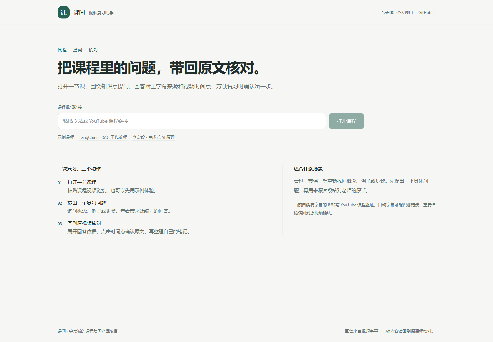
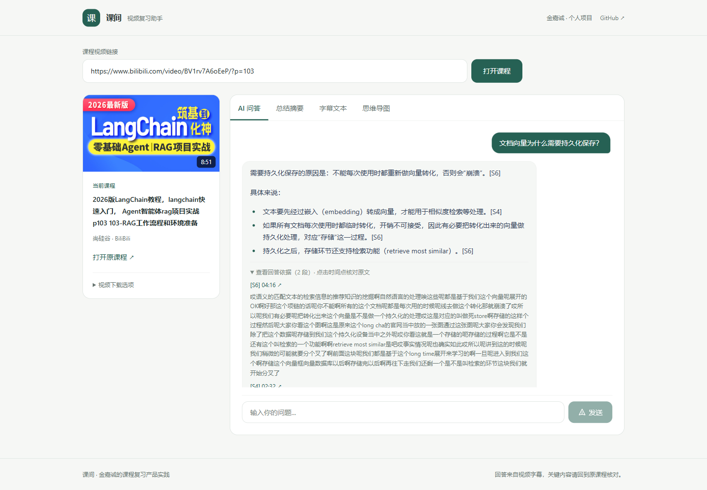
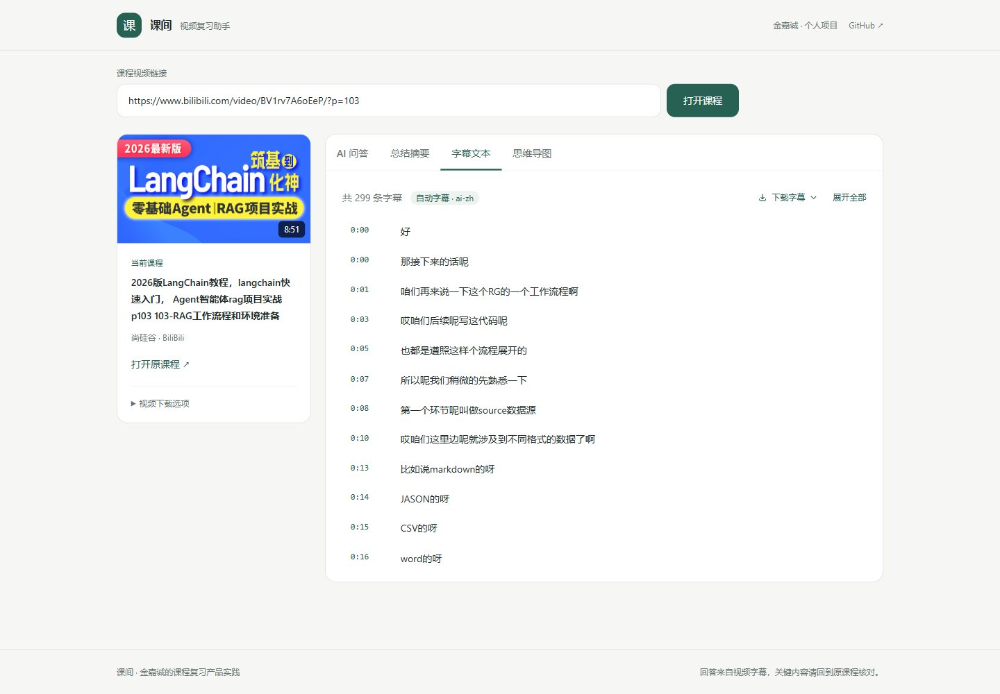

# 课间 · 课程视频复习助手

我从 0 到 1 搭建了“课间”，面向课程复习中的知识点查找、提问与原文核对，作为个人产品项目持续迭代。

项目仓库：[kejian_reviewAI](https://github.com/j1799340632/kejian_reviewAI)。

个人演示界面围绕课程复习组织。打开课程后默认进入问答；字幕按需读取，摘要和思维导图点击后生成。视频下载位于课程卡片内的折叠选项，首页保留真实课程示例、使用步骤及 GitHub 项目链接。

我希望帮助观看课程和讲座的学生整理知识点、提问并核对视频原文，这是我选择的优先用户场景。

输入视频链接后可生成摘要和思维导图。网页问答在 48,000 字符的已入库文本预算内使用全部片段，超预算时使用混合检索，展示来源编号和时间点；链接支持按时间点打开。

回答下方的“回答依据”仅展示答案标注引用的片段，保留原来源编号并去重；完整字幕保留在“字幕文本”标签中。

## 应用截图

以下是本地应用的实际界面，问答截图保留当次真实输出。

### 课程入口

我将课程链接、真实示例和复习步骤集中在首页，打开课程后直接进入问答。



### 问答与回答依据

答案标注来源编号，下方只展示实际引用的片段，并提供返回原视频的时间链接。



### 完整字幕

完整的带时间戳字幕放在独立标签中，按需读取，不会自动触发摘要生成。



## 产品文档与验证记录

产品材料：[产品需求](docs/product/PRD.md) · [评测方案](docs/product/EVALUATION.md) · [项目证据与修改记录](docs/product/PROJECT_EVIDENCE.md)。

我与 AI 工具的协作分工记录在[我的参与记录](docs/product/AUTHOR_PARTICIPATION.md)。我在页面检查中发现来源展示过多，并确定了简化界面的方向；本轮手工验收已完成。

我使用评测脚本完成了首轮真实调用：[5 道课程问题的三组对比结果](docs/product/FIRST_EVALUATION_RESULTS.md)。

我按[个人项目验证流程](docs/product/SELF_TEST_WORKFLOW.md)推进课程核查、系统测试与后续独立问题检验，进度见[测试记录](docs/product/SELF_TEST_LOG.md)。

我使用 AI 工具完成补充测试并整理记录：[10 道补充题与真实网页实测](docs/product/COURSE_CHECK_RESULTS.md)。同课程小样本中，AI 按字幕评审为 6 道满足要点、4 道部分完成。

随后，我推进了[第一次质量迭代](docs/product/ITERATION_01_RESULTS.md)：比较三种上下文候选并接入短内容路径；原补充 10 题复测为 9 道满足要求、1 道部分完成，同时记录输入 token 增加的取舍。

我又补充了[另一门课程与真实长字幕检验](docs/product/INDEPENDENT_LONG_RESULTS.md)：李宏毅 2025 秋季第 1 讲，35,705 字符、约 105 分钟，固定 10 题后完成两组共 20 次调用。当时方案为 4 道满足、5 道部分、1 道失败，暴露前段漏召回与字幕错词问题。

随后，我推进了[第二次质量迭代](docs/product/ITERATION_02_RESULTS.md)：比较四种上下文候选，扩大预算并增加代码写法检查；同规则下旧 25 题的可见回答为原方案 16 道满足、当前 23 道满足，新 6 题为原方案 5 道、当前 6 道。输入量增加、原始模型仍犯的参数错误、未解决的漏答均单列保留。长课真实网页两次提问与后段来源打开通过。


---

## 功能

- **多平台视频解析下载** —— 基于 yt-dlp，支持 B 站、YouTube 等主流平台，可选清晰度
- **AI 内容总结** —— 提取字幕后调用大模型生成结构化摘要，流式输出
- **思维导图** —— 自动生成层级结构，支持缩放和导出图片
- **视频问答** —— 字幕索引复用、混合检索、带来源编号的回答与时间点核查
- **字幕导出** —— 支持 SRT / VTT / TXT 格式
- **个人项目工作台** —— 无需账号，默认课程问答，按需读取字幕与生成复习材料

---

## 技术栈

| 层 | 技术 |
|---|---|
| 前端 | Vue 3 + Vite + Tailwind CSS |
| 后端 | FastAPI |
| 视频解析 | yt-dlp |
| 大模型 | DeepSeek |
| 向量检索 | Milvus + bge-small-zh + BM25 |

---

## 核心设计：为什么要做 RAG

原网页问答只使用前 12,000 字符；摘要和思维导图只使用前 15,000 字符。不能根据视频时长直接推算固定丢失比例，应按每份字幕实际长度计算。

```python
truncated = subtitle_text[:12000]  # 原问答基线，目前保留用于对照
```

如果问题的依据在截断范围之外，原方案无法读取该依据。它可能拒答，也可能生成没有依据的回答；具体比例尚未测量。

当前链路：

```
字幕 segments（带时间戳）
   └→ 滑动窗口分块（400 字，80 字重叠）
        └→ bge 向量化 → 存入 Milvus
                            ↓
网页提问 → URL 建索引 / video_id 复用 → 读取已入库片段
                                      ├→ 总文本 ≤48000 字符（含重叠）→ 全部片段
                                      └→ 超预算 → 向量 + BM25 → RRF → Top-3
                                                               ↓
                                                            LLM 生成
                                                               └→ 不确定代码写法提示 + 可展开来源与时间点
```

我在当前实现中作了以下取舍：

- **混合检索**：纯向量检索对专有名词不敏感，BM25 能补上。
- **RRF 融合**：通过排名融合两路结果，减少直接比较不同量纲分数的困难。当前使用固定参数，是否优于纯向量检索需要同一评测集验证。
- **所有视频共用一个 collection**：用 `video_id` 字段过滤，而不是每个视频建一个 collection —— Milvus 的 collection 有数量上限，频繁建删会拖慢加载。


---

## 快速开始

### 环境要求

- Python 3.10+
- Node.js 20.19+（20.x）或 22.12+，以当前 Vite 的版本要求为准
- Docker（运行 Milvus 用）
- 一个 [DeepSeek API Key](https://platform.deepseek.com)

### 1. 后端

```bash
cd backend

pip install -r requirements.txt

cp .env.example .env
# 编辑 .env，填入 DEEPSEEK_API_KEY 
# 可用 DEEPSEEK_MODEL 配置模型名，默认 deepseek-flash

python main.py
```

启动后访问 <http://localhost:8000/docs> 可看接口文档。

### 2. 前端

新开一个终端：

```bash
cd frontend
npm install
npm run dev
```

访问 <http://localhost:5173>

### 3. Milvus（问答功能需要）

```bash
docker compose -f docker-compose.eval.yml up -d
```

```bash
docker compose -f docker-compose.eval.yml ps
```

然后自检：

```bash
cd backend
python check_milvus.py
```

这是本地嵌入式 Milvus 配置。完整组件配置另见 `docker-compose.milvus.yml`，其 Attu 界面使用 8001，后端接口使用 8000；本机尝试拉取原 MinIO 镜像失败，因此本轮联调使用嵌入式配置。

首次问答会提取字幕、加载向量模型并建立索引，耗时可能较长。后续请求复用返回的 video_id，不再传输字幕全文。

当前限制：摘要和思维导图仍只处理前 15,000 字符，长字幕会显示范围提示；问答没有多轮对话记忆，超预算路径的 Top-3 不能保证概括整段课程。全部片段路径会增加输入 token；48,000 字符预算包含重叠，尚未验证最优阈值或超过新预算的真实质量。代码检查只核对部分表达式的文字出处，不保证代码和知识正确。输出按行流式显示，字幕时间点按块定位，并非逐字定位。

### 开发验证

```bash
python -m unittest discover -s tests -v
cd frontend
npm test
npm run build
```

后端自动测试替换了外部字幕提取、Milvus 和模型调用；它们验证接口行为，不代表真实课程的问答质量。运行后端测试需要安装后端依赖。


---

## 项目结构

```
.
├── backend/
│   ├── main.py              FastAPI 入口，视频解析下载接口
│   ├── downloader.py        yt-dlp 封装
│   ├── douyin.py            抖音专用解析
│   ├── summarizer.py        字幕提取 + 大模型调用
│   ├── api_summarize.py     字幕读取、总结 / 问答接口（SSE 流式）
│   │
│   ├── chunker.py           字幕分块（保留时间戳）
│   ├── embedder.py          bge 向量化
│   ├── vector_store.py      Milvus 读写
│   ├── retriever.py         混合检索 + RRF 融合
│   ├── rag_service.py       网页问答的索引复用与来源整理
│   ├── context_policy.py    上下文预算与评测候选
│   ├── answer_guard.py      不确定代码表达式的显示检查
│   ├── evaluate_course.py   固定字幕的上下文与回答对比
│   ├── check_milvus.py      环境自检脚本
│   └── demo_rag.py          端到端演示
│
├── frontend/
│   └── src/
│       ├── App.vue
│       ├── components/      页面组件
│       └── api/             接口封装
│
└── docker-compose.milvus.yml
```

---
