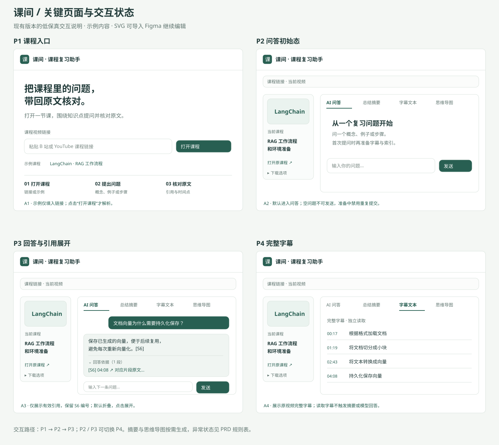

# 课程视频复习问答产品需求

本轮面向观看课程、讲座并需要整理重点和复习的学生。当前无法招募外部学生，先采用我的任务自测与课程离线评测，验证具体任务和回答依据；操作见[个人项目验证流程](SELF_TEST_WORKFLOW.md)。

我在 P103 页面检查中发现来源区疑似展开整集字幕，并确定仅展示答案引用片段、完整字幕独立查看的方案。本轮已据此实现前端筛选并完成回放检查，见[页面检查记录](SELF_TEST_LOG.md#回答依据展示改进历史)。

当前页面采用课程复习工作台：默认进入问答、按需读取字幕及生成摘要，下载移至次要位置；账号接口及摘要账号次数限制均已移除。39 项后端、8 项前端测试和真实匿名网页流程通过，详见[最新验证](SELF_TEST_LOG.md)。此轮不改变既有回答质量评分。

首批课程题目已完成三组真实调用，见[首轮评测结果](FIRST_EVALUATION_RESULTS.md)。该小样本显示固定 Top-3 会遗漏组合问题的部分依据；后续优先验证子问题召回及短字幕全文路径。

补充 10 道同课程题与真实网页操作已完成，见[实测结果](COURSE_CHECK_RESULTS.md)。AI 按字幕评审为 6 道满足要点、4 道部分完成，两道无答案题均未编造数字。新的诊断支持继续优先修复证据覆盖；未验证外部用户需求、独立课程泛化或学习效率。

后续[第一次质量迭代](ITERATION_01_RESULTS.md)已比较短内容全片段、Top-6、规则拆题三种候选，并在网页接入短内容全片段路径。预算为全部片段合计 12,000 字符（含重叠），超预算保留混合 Top-3。复测原补充 10 题为 9 道满足要求、1 道因额外例子无依据而部分完成；同批 15 题输入 token 约增加至 3.98 倍。质量优先的选择及成本代价均保留，后续用独立样本检验。

随后完成[不同课程的长字幕首次检验](INDEPENDENT_LONG_RESULTS.md)：新增李宏毅课程、35,705 字符真实字幕与 10 道冻结题，两组共 20 次调用。当时策略能回答部分后段问题，但有前段漏召回、跨片段遗漏、生成漏答及字幕术语误读。该阶段保持产品策略不变，保留问题供下一次迭代，不把小样本计数当成学生复习效果。

后续[第二轮迭代](ITERATION_02_RESULTS.md)完成了上述工作：比较四种候选，对预算内全部已入库片段扩大至 48,000 字符（含重叠），并增加不确定代码写法提示。相同修订规则下旧 25 题从 16 道满足要求变为 23 道；6 道预先固定的新题为 6 道满足。仍有生成漏答，原始模型参数错误通过显示检查提示核对而非自动改正。长课程真实网页两次提问与 S93 时间链接打开通过，输入增加和质量边界单列记录；没有学生学习效果结论。

## 问题与现有证据

改造前的代码已经提供字幕、摘要、思维导图和问答页面，也包含分块、向量检索、BM25 与 RRF 模块。但网页 `/api/chat` 仍调用字幕前 12,000 字符的问答方法；RAG 仅在 `demo_rag.py` 中演示。摘要和思维导图使用前 15,000 字符。

这些事实说明：视频后段的字幕可能没有进入原问答上下文，且功能介绍比实际网页链路更完整。它们不能证明用户遇到问题的频率，也不能推算问答准确率。

## 需要验证的用户假设

| 假设 | 验证方式 | 支持或推翻假设的证据 |
|---|---|---|
| 学生复习时会回到已看过的课程查找概念、例子和步骤 | 先记录我近期的真实经历及一次个人任务；有条件时再访谈他人 | 实际查询内容、使用工具、完成路径与耗时；单人记录不能代表群体 |
| 回答附带原视频片段能帮助学生核对内容 | 我打开引用，核对原讲解与回答；后续再做外部试用 | 链接能否定位、依据是否支持关键说法、能否发现错误；暂不推断群体效率提升 |
| 后段字幕与专有术语值得优先优化 | 分开记录我实际提出的问题和 AI 起草评测题，标注依据所在位置 | 可复现的失败案例及修复结果；人工设计的样本分布不代表真实需求占比 |
| 摘要与思维导图是学生整理重点的有效入口 | 记录我整理一次复习笔记的过程 | 实际采用、编辑、放弃的内容和原因；其他学生是否采用仍待验证 |

以上均为假设；尚无访谈人数、活跃用户、满意度或留存数据。

## 本轮产品决策

先完成“针对课程提问—查看相关片段—返回视频核对”的路径。它能直接利用现有检索代码，也能让问题是否解决得到逐条验证。长视频完整摘要同样重要，但需要另行设计分段归纳和全局组织，不能用 Top-3 检索片段替代完整课程提纲。

| 优先级 | 功能 | 本轮行为及边界 |
|---|---|---|
| P0 | 网页课程问答 | 首次按 URL 建立字幕索引，后续复用 video_id；已入库文本 ≤48,000 字符（含重叠）时全部提供，超预算继续混合检索 |
| P0 | 依据核查 | 仅展示答案标注引用且确实存在的来源，保留原编号并去重；完整字幕保留在字幕标签；支持 B 站、YouTube 时间链接 |
| P0 | 个人演示入口 | 无需账号；打开课程默认问答，字幕读取不调用模型，摘要和思维导图按点击生成；下载选项默认折叠 |
| P0 | 不确定代码写法 | 对可识别的新参数赋值或数值索引，原文不能确认时显示核对提示；不猜测正确字段，不保证所有代码正确 |
| P0 | 无法完成时的反馈 | 无字幕、无可用检索片段、服务错误和中断时显示可理解的反馈 |
| P0 | 摘要范围提示 | 字幕超过处理范围时，说明摘要和思维导图可能遗漏后续内容 |
| P0 | 对比评测准备 | 固定基线、样本标注规则与失败类型，不先设定提升幅度 |
| P1 | 全片整理与复习 | 分段摘要、课程知识提纲和完整性验证；先结合我的任务记录排序，后续再用外部反馈验证 |
| P1 | 多轮追问 | 历史消息传递、指代解析及上下文控制；当前没有实现 |
| P2 | 自动复习计划或 Agent | 只有在复习任务得到验证后，再判断是否需要任务编排 |

## 设计图与原型

我将当前版本的用户路径、页面状态和问答链路整理为以下设计图，用于需求评审与项目讲解。页面示意中的文案仅用于说明交互，实际回答以应用运行结果为准。

- [本地可点击原型](../design/interactive-prototype.html)：下载后用浏览器打开，可演示正常问答、无字幕、打开课程失败和回答中断；使用示例内容，不调用外部服务。
- [页面原型 SVG](../design/wireframes.svg)：可导入 Figma 继续编辑。
- 流程图同时保留 Mermaid 源文件，便于随需求修改和重新导出。

### 图 1：用户主流程与异常路径

我将默认问答作为主路径，字幕和摘要作为按需进入的辅助功能；“整理笔记”属于学生在自己的笔记工具中完成的后续行为。

[查看流程大图](../design/user-flow.svg) · [编辑流程定义](../design/user-flow.mmd)

1. 学生输入课程视频链接，默认进入问答，无账号步骤；可在字幕标签独立读取原文。
2. 需要摘要与思维导图时主动点击生成；长字幕标注范围限制，避免被当成完整课程笔记。
3. 学生输入具体问题，例如“老师如何解释这个概念”“这个方法的步骤是什么”。
4. 首次问答提示正在准备；后续同视频复用索引。
5. 回答引用来源编号，页面仅展示被标注引用的片段及时间点；学生可打开原视频核查，也可在字幕标签查看全文。
6. 没有字幕、检索为空或服务失败时，给出反馈，允许调整问题或重试。

### 图 2：关键页面与交互状态

我用四个状态说明三个主要界面的关系：P1 课程入口、P2 问答初始态、P3 回答与引用展开、P4 完整字幕。问答生成时的等待与错误恢复另见下方规则表。

原型演示顺序：P1 点击示例并打开课程 → P2 提问 → P3 展开回答依据 → 点击时间链接核对；P2、P3 均可切换到 P4。点击摘要生成按钮后，才展示摘要与思维导图。

### 图 3：AI 问答与依据展示流程

我将索引准备、上下文选择、回答展示分成三个阶段。图中的 48,000 字符包括分块重叠；超过预算时才走混合 Top-3 检索。无字幕或无可用片段时不调用回答模型。

[查看流程大图](../design/rag-flow.svg) · [编辑流程定义](../design/rag-flow.mmd)

代码写法检查只提供有限的原文核对提示，引用筛选只决定展示哪些来源；二者不保证事实正确或引用充分。字幕读取使用独立接口，不经过图中的回答模型；摘要与思维导图使用单独的按需生成路径，仍有前 15,000 字符的处理范围限制。

### 交互规则与状态约定

| 编号 | 触发场景 | 用户可见行为与规则 |
|---|---|---|
| A1 | 输入链接、选择示例、打开课程 | 示例只填入链接，点击“打开课程”才解析；解析时禁用重复提交。失败时保留链接并展示错误，允许修改后重试。 |
| A2 | 打开课程、首次提问、同视频再次提问 | 默认进入问答，不自动生成摘要；空问题不可发送。准备与生成期间禁用重复发送，结束或失败后恢复输入。同视频复用索引，但当前没有多轮对话记忆。 |
| A3 | 回答生成、展开引用、点击时间点 | 依据默认折叠，只显示答案标注且确实存在的来源，去重并保留 S6 等原编号。无引用或未知编号不回退展示全部片段。支持平台的时间链接在新页打开，按字幕块近似定位。 |
| A4 | 切换字幕标签 | 独立读取完整字幕，不调用回答模型，也不触发摘要生成。读取中显示状态，失败时允许重试，无字幕时显示明确说明。 |
| A5 | 点击生成摘要与思维导图 | 主动点击后生成，切换标签本身不触发生成。长字幕超过处理范围时提示可能遗漏后续内容，避免当作完整课程提纲。 |
| A6 | 无字幕、没有可用片段、服务失败或回答中断 | 显示原因与可继续操作的入口；无字幕时更换课程，无可用依据时调整问题，服务恢复后可重新发送。模型可能在有片段时仍漏答，不能只根据界面成功判断答案正确。 |
| A7 | 切换课程 | 清空当前页面的问答、摘要与字幕状态，避免沿用上一视频的内容；新课程的问题按自身 URL / video_id 处理。 |

## 验收标准

| 场景 | 期望行为 | 验证方法 |
|---|---|---|
| 首次提问 | 字幕分块入库，检索结果传给回答模型 | 接口自动测试与真实服务联调分别验证 |
| 同视频再次提问 | 使用 video_id，不上传字幕全文，不重复索引 | 请求体检查、调用记录与索引条数检查 |
| 依据在旧截断范围之外 | 入库阶段保留对应片段；检索是否命中单独评测 | 构造样本回归与真实长课程评测 |
| 查看来源 | 仅列出答案标注且可用的片段，去重并保留原编号、原文和时间点；无引用不回退展示全文 | 引用筛选单测、浏览器回放及手工复验（已完成，本人确认） |
| 无账号使用 | 不出现登录注册入口，账号接口不再挂载；字幕、摘要与问答可匿名使用 | 接口回归、真实匿名浏览器流程 |
| 按需生成 | 打开课程、读取字幕均不触发摘要生成；点击按钮才生成摘要与思维导图 | 浏览器请求检查与页面回归 |
| 无字幕或检索为空 | 不生成无依据答案，显示相应反馈 | 接口回归测试 |
| 检索返回无关片段 | 模型应说明片段不足以回答 | 真实无答案问题人工评审；当前只有 Prompt 约束 |
| 长视频摘要 | 明确提示处理范围限制 | 接口测试、前端事件测试与页面核查 |
| 生成失败或流中断 | 显示失败或中断，恢复提问能力 | 接口错误回归与浏览器人工断流检查 |

## 需要记录的指标

核心观察对象是学生能否根据视频完成复习问题并核查依据。第一轮先记录检索证据命中、答案正确、引用支持、正确拒答和任务耗时；具体定义见评测方案。工程测试通过不等于这些指标达到要求。

个人自测时，我会记录任务是否完成、核查来源的行为、结果采纳及放弃原因，并说明参与者仅为我。有条件进入外部试用后，再记录相应外部任务数据。暂不宣称学习成绩、复习效率或留存得到提升。

## 当前验证路径与后续访谈

当前依次完成：记录我的真实复习场景；核对首批题的参考要点；固定新的检验题；在开发题上比较修复方案；运行新题并完成一次网页任务；整理结果及限制。具体操作及记录见[验证流程](SELF_TEST_WORKFLOW.md)和[自测记录](SELF_TEST_LOG.md)。AI 起草的 5 道题不直接算作真实需求样本，未核对的参考要点不算人工标准答案。

将来有招募条件时，可邀请近期看过课程或讲座的学生做探索性访谈，人数按实际可招募情况记录。访谈用于发现问题，不能推断市场占比；它不阻碍当前个人项目验证。

- 请回忆最近一次复习视频课程的经历，具体要完成什么任务？
- 当时如何找回某个知识点，使用了字幕、进度条、笔记还是搜索？
- 最后一次找不到信息是什么情况，如何处理？
- 观察学生完成一次查找任务，不预先告诉对方应使用 AI。
- 试用后询问哪些内容被采用、哪些需要修改，以及什么证据会让其相信答案。

## 技术与产品限制

索引目前按完整 URL 标识，同一视频的不同链接可能重复入库；并发索引锁仅在单进程内有效。字幕块时间点是近似定位，超长单条字幕及文本截取需要另做边界验证。没有转写能力，无字幕视频暂不支持；自动字幕自身可能有错误。当前不执行真实多轮对话，也没有对模型引用的语义支持进行自动逐条校验。代码表达式检查只提供有限的写法核对，不是语义正确性验证；48,000 字符阈值为工程预设，超过该范围的真实质量未测。完整上下文会增加输入用量；按引用筛选减少展示数量，但不保证被引用的片段真正支持回答。
